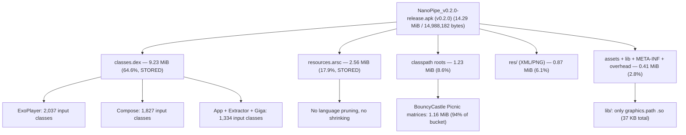
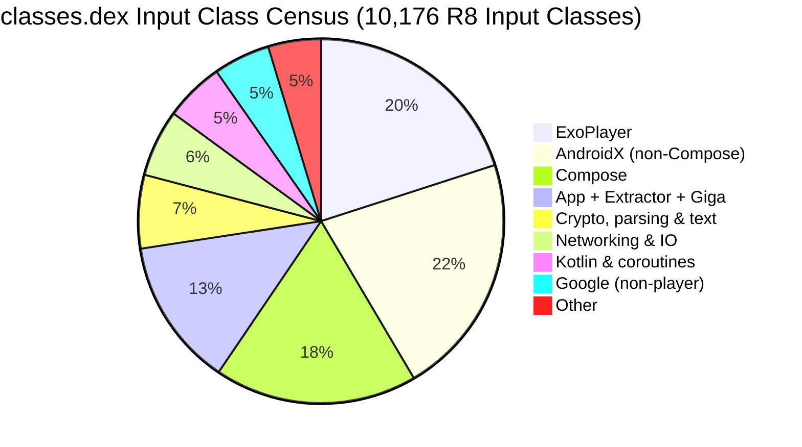
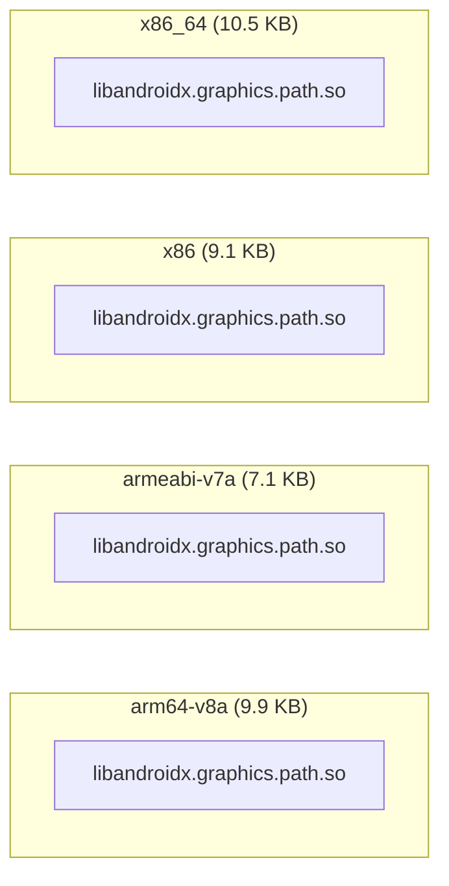

# NanoPipe Release APK Size Analysis & Binary Footprint Report (v0.2.0)

This report provides a comprehensive, quantitative analysis of the binary footprint, package composition, Dalvik bytecode structure, native shared libraries, asset payloads, and resource overhead in the release APK of **NanoPipe v0.2.0** (`PipePipeClient/app/build/outputs/apk/release/NanoPipe_v0.2.0-release.apk`). It follows the methodology of the mumla-oled `docs/apk-size-analysis` series so the reports can be compared section by section.

> [!NOTE]
> **No version skew**: the analyzed APK was built from tag `v0.2.0` itself (`versionCode 111000`, `versionName 0.2.0` per `PipePipeClient/app/build/outputs/apk/release/output-metadata.json`) — `git describe --tags --long HEAD` resolves to `v0.2.0-0-g02d4a97`, i.e. `HEAD` is exactly the tagged commit.

All paths below are relative to the repository root.

---

## 1. Executive Summary & Top-Level Metrics

The release artifact is built with R8 minification (`minifyEnabled = true`) but **without** resource shrinking (`shrinkResources false`, disabled to fix F-Droid's reproducible build) — see [`PipePipeClient/app/build.gradle`](../../PipePipeClient/app/build.gradle#L101-L102).



### Global Artifact Metrics

| Metric | Measured Value | Human Readable | Notes |
| :--- | :--- | :--- | :--- |
| **Analyzed Version** | `0.2.0` (`versionCode 111000`) | — | Version analyzed in this report |
| **Download / On-Disk Size (Compressed)** | `14,988,182 bytes` | **14.29 MiB** (~15.0 MB) | Exact byte count of the signed release APK |
| **ZIP Content Payload (Compressed)** | `14,749,293 bytes` | **14.07 MiB** | Sum of compressed entry streams (excludes signing block) |
| **APK Signing Block & ZIP Central Directory** | `238,889 bytes` | **233.3 KiB** (1.59%) | v2/v3 signatures plus archive index overhead |
| **Installed / Unpacked Size (Uncompressed)** | `16,077,545 bytes` | **15.33 MiB** (~16.1 MB) | Sum of all internal uncompressed payload streams |
| **Overall Compression Ratio** | `91.74%` | — | Ratio of compressed content to uncompressed contents |
| **Total Files Inside Archive** | `1,723 files` | — | Includes classes, shared objects, resources, metadata |
| **Target Application ID** | `ca.bualy.pipepipefork` | — | Configured in [`PipePipeClient/app/build.gradle`](../../PipePipeClient/app/build.gradle#L50) |
| **DEX Compilation Strategy** | Single DEX (`classes.dex`) | — | Single DEX **039** archive; no multidex split in release |
| **Target ABIs** | `arm64-v8a`, `armeabi-v7a`, `x86`, `x86_64` | — | Multi-architecture universal APK (near-empty `lib/`) |
| **Minimum / Target SDK** | `30` / `36` | Android 11+ | Configured in [`PipePipeClient/app/build.gradle`](../../PipePipeClient/app/build.gradle#L51-L53) |

The 91.74% compression ratio looks anomalous next to mumla-oled's ~63% — it is the signature of **stored (uncompressed) DEX packaging**: `classes.dex` alone (9.23 MiB, 64.6% of the APK) is stored verbatim, so the APK barely compresses. Re-deflating just the DEX at zlib level 6 shrinks it from 9,678,680 to ~4,324,412 bytes (44.7%), which is optimization #1 in §6.

### Delta vs Debug Build (`v0.1.0-20-g02d4a97-debug`)

The sibling debug artifact (`NanoPipe_v0.1.0-20-g02d4a97-debug.apk`, 102,795,305 bytes) shows what R8 buys. Debug is not a size baseline — it only isolates the minification delta (see paragraph below the table):

| Metric | Debug | Release (v0.2.0) | Delta |
| :--- | :--- | :--- | :--- |
| **APK on-disk size** | `102,795,305 B` | `14,988,182 B` | **`−87,807,123 B` (−85.4%)** |
| **DEX payload** | `97,144,388 B` (38 files, STORED) | `9,678,680 B` (1 file, STORED) | **−90.0%** (R8 + single-DEX) |
| **File count** | 1,845 | 1,723 | −122 files |
| **`res/`** | `1,043,232 B` / 1,647 files | `910,191 B` / 1,559 files | −12.8% |
| **`lib/`** | `37,392 B` (identical) | `37,392 B` (identical) | Flat (no native code to shrink) |
| **Method references** | 356,468 (over 38 DEX files) | 57,814 (single DEX) | −83.8% |

Debug carries 38 `classes*.dex` files (54,495 class definitions, 356,468 method references — inherently unshrinkable without minification); release R8 collapses that to one 9.23 MiB DEX. The debug APK is therefore not a size baseline — it only confirms that minification, not feature code, dominates the ~88 MB gap.

---

## 2. Global Archive Composition Breakdown

The archive contents break down across seven functional categories (percentages of the on-disk APK file):

| Category | Compressed Size | % of Total APK | Uncompressed Size | % of Uncompressed | File Count |
| :--- | :--- | :--- | :--- | :--- | :--- |
| **Bytecode (`classes.dex`)** | `9,678,680 B` | **64.58%** | `9,678,680 B` | **60.20%** | 1 |
| **Compiled Table (`resources.arsc`)** | `2,680,776 B` | **17.89%** | `2,680,776 B` | **16.67%** | 1 |
| **Classpath Roots (`org/`, `google/`, `kotlin/`)** | `1,291,506 B` | **8.62%** | `1,514,977 B` | **9.42%** | 26 |
| **App Resources (`res/`)** | `910,191 B` | **6.07%** | `1,639,649 B` | **10.20%** | 1,559 |
| **Assets (`assets/`)** | `114,177 B` | **0.76%** | `411,429 B` | **2.56%** | 7 |
| **Native Libraries (`lib/`)** | `37,392 B` | **0.25%** | `37,392 B` | **0.23%** | 4 |
| **Signatures, Manifest & Meta** | `35,450 B` | **0.24%** | `112,233 B` | **0.70%** | 121 |
| **Signing Block & ZIP Index Overhead** | `238,889 B` | **1.59%** | — | — | — |
| **Other (bin, version, tooling)** | `1,121 B` | **0.01%** | `2,409 B` | **0.01%** | 4 |
| **Total (on-disk APK)** | **`14,988,182 B`** | **100.00%** | **`16,077,545 B`** | **100.00%** | **1,723** |

*Shares are rounded to two decimals (compressed column sums to 100.01%, uncompressed to 99.99%).*

Two structural contrasts with mumla-oled stand out immediately: there is **no model-weights `assets/` payload** (no ML in this app — `assets/` is under 1%), and `lib/` is effectively vestigial at 0.25% (the ffmpeg-kit native blob was removed; see §5). The APK is a **bytecode + resource-table** package: DEX and `resources.arsc` together are 82.5% of every download.

### Breakdown by File Extension

| Extension | Compressed Size | % APK | Uncompressed Size | File Count | Primary Contents |
| :--- | :--- | :--- | :--- | :--- | :--- |
| `.dex` | `9,678,680 B` | 64.58% | `9,678,680 B` | 1 | Application and dependency Dalvik bytecode (STORED) |
| `.arsc` | `2,680,776 B` | 17.89% | `2,680,776 B` | 1 | Compiled resource string & ID lookup table (STORED) |
| `.properties` | `1,239,244 B` | 8.27% | `1,341,749 B` | 7 | BouncyCastle PQC matrices + cert-path messages + entities |
| `.xml` | `497,111 B` | 3.32% | `1,254,500 B` | 1,152 | Binary Android layouts and vector drawables (+ manifest) |
| `.png` | `418,081 B` | 2.79% | `418,081 B` | 407 | Launcher art, thumbnails, legacy drawables (STORED as-is) |
| `.js` | `65,240 B` | 0.44% | `272,239 B` | 4 | Extractor YouTube solver scripts + SABR PoToken |
| `.list` | `42,484 B` | 0.28% | `132,737 B` | 1 | OkHttp public-suffix database (`assets/`) |
| `.proto` | `39,963 B` | 0.27% | `119,888 B` | 12 | Protobuf `.proto` sources leaking from protobuf-java |
| `.so` | `37,392 B` | 0.25% | `37,392 B` | 4 | `libandroidx.graphics.path.so` × 4 ABIs (STORED) |
| `.txt` | `24,996 B` | 0.17% | `71,278 B` | 8 | 7× AndroidX `LICENSE.txt` + multidex version stamp |
| `.kotlin_builtins` | `12,350 B` | 0.08% | `53,396 B` | 8 | Kotlin runtime reflection metadata |
| Other (`.prof`, `.ttf`, `.bin`, `.md`, `.version`, services) | `12,976 B` | 0.09% | `16,829 B` | 118 | Baseline profile, font, coroutine probes, version markers |

No `.SF` / `.MF` / `.RSA` — the APK is signed with v2/v3 signatures only (APK Signing Block magic present), so no v1 JAR-signing manifests bloat `META-INF/`.

---

## 3. Deep Dive: Dalvik Executable Bytecode (`classes.dex`)

[`classes.dex`](../../PipePipeClient/app/build/outputs/apk/release/NanoPipe_v0.2.0-release.apk) is nearly two-thirds of the package at **9.23 MiB**, stored uncompressed (zip method 0). DEX 039 is retained.



### Low-Level DEX Header Metrics

Extracted directly from the binary DEX 039 header:

| DEX Header Field | Measured Value | Android 64K Limit | Margin Remaining |
| :--- | :--- | :--- | :--- |
| **Class Definitions (`class_defs_size`)** | `9,259` | Unlimited | — |
| **Method References (`method_ids_size`)** | `57,814` | 65,536 | **7,722 methods (11.8% headroom)** |
| **Field References (`field_ids_size`)** | `39,188` | 65,536 | 26,348 fields (40.2% headroom) |
| **Type IDs (`type_ids_size`)** | `11,103` | 65,536 | 54,433 types |
| **String IDs (`string_ids_size`)** | `69,090` | — (32-bit index) | n/a |
| **Prototype IDs (`proto_ids_size`)** | `13,991` | 65,536 | 51,545 prototypes |

> [!WARNING]
> **Multidex headroom is thin**: 57,814 of 65,536 method references are consumed (88.2%). The app still fits in a single primary DEX today, but ~7.7 K references of growth — one more large media dependency — forces a multidex split. `multiDexEnabled true` is already set in [`PipePipeClient/app/build.gradle`](../../PipePipeClient/app/build.gradle#L56), so the split would work, at the cost of startup time and a second DEX entry.

### Class Retention Census by Dependency Package

R8 minification and tree shaking (`minifyEnabled = true`) records **10,176 input classes** (9,259 class definitions survive into the final DEX header) and 520,987 method-mapping entries in [`mapping.txt`](../../PipePipeClient/app/build/outputs/mapping/release/mapping.txt) (R8 9.2.14, `min_api: 30`). Method mappings are counted as indented `->` entries carrying a method signature, excluding 5,019 field entries and R8 `#` diagnostic lines. Note the build sets `-dontobfuscate` in [`proguard-rules.pro`](../../PipePipeClient/app/proguard-rules.pro), so names are kept readable — shrinking still applies, and the ~9:1 ratio of input method entries to retained references is the normal shape of a shaken commercial-size DEX:

| Package Prefix | Input Classes | Mapped Method Entries | Dominant Role / Purpose |
| :--- | :--- | :--- | :--- |
| **`com.google.android.exoplayer2.*`** | **2,037** | **61,123** | Media3/ExoPlayer playback core (wildcard-kept, see below) |
| **`androidx.compose.*`** | **1,827** | **99,308** | Compose runtime, foundation, Material3, icons-extended |
| **`org.schabi.newpipe.app.*`** | **934** | **71,500** | Activities, fragments, player UI, downloader, settings |
| `androidx.car.*` | 389 | 5,530 | Android Auto / car-app API surface |
| `io.reactivex.*` | 325 | 8,317 | RxJava3 reactive chains (Room + Work integrations) |
| `com.google.android.material.*` | 321 | 30,785 | Material components (non-Compose widgets) |
| **`org.bouncycastle.*`** | **312** | **11,998** | Crypto provider via extractor (`bcprov-jdk18on:1.85`) |
| **`org.schabi.newpipe.extractor.*`** | **312** | **17,002** | YouTube/service extraction logic (in-tree build) |
| `kotlinx.*` | 291 | 8,831 | Coroutines runtime |
| `androidx.core.*` | 286 | 8,136 | Platform compatibility shims |
| `androidx.appcompat.*` | 247 | 18,799 | AppCompat widgets and themes |
| `kotlin.*` | 244 | 13,580 | Kotlin stdlib |
| `androidx.work.*` | 204 | 12,255 | Background download workers |
| `org.jsoup.*` | 200 | 11,506 | HTML parsing for extractors |
| `com.google.common.*` | 188 | 4,189 | Guava (ExoPlayer transitive) |
| `okhttp3.*` + `okio.*` | 245 | 25,305 | HTTP stack (182 + 63 classes, method-dense) |
| `androidx.room.*` | 143 | 7,024 | Local database (subscriptions, history) |
| `org.acra.*` | 117 | 6,468 | Crash reporting (ACRA 5.13.1) |
| `androidx.fragment.*` | 113 | 8,987 | Fragment lifecycle |
| `androidx.recyclerview.*` | 103 | 11,641 | Lists (search, channels, comments) |
| `org.ocpsoft.prettytime.*` | 100 | 1,349 | Relative-time formatting (explicitly kept) |
| `us.shandian.*` (Giga downloader, in-repo) | 88 | 9,395 | Download missions, `giga` service, HLS/postprocessing |
| `io.noties.*` (Markwon) | 36 | 1,095 | Markdown rendering |
| `com.xwray.groupie.*` (Groupie) | 18 | 586 | Groupie list items |
| Other (lifecycle, sqlite, constraintlayout, …) | 1,096 | 66,278 | Long tail: 60+ small packages (leakcanary, webkit, brotli, …) |

### Why ExoPlayer Accounts for 20% of Input Classes

The direct analogue of mumla-oled's old BouncyCastle wildcard is in [`PipePipeClient/app/proguard-rules.pro`](../../PipePipeClient/app/proguard-rules.pro):

```pro
-keep class com.google.android.exoplayer2.** { *; }
```

All 2,037 ExoPlayer classes (pinned at 2.18.7 in [`build.gradle`](../../PipePipeClient/app/build.gradle#L236-L237), plus `extension-mediasession`) are retained unconditionally, including renderers, extractors for formats the app never plays, and upstream track-selection machinery. ExoPlayer resolves most components statically, so this wildcard is a far better stripping candidate than BouncyCastle's reflection-driven provider ever was — see optimization #4 in §6. Secondarily, `androidx.compose` (1,827 classes, 99,308 method entries — the largest per-package entry total) arrives via six Compose artifacts (four at 1.11.3, plus material3 1.4.0 and material-icons-extended 1.7.8), and `androidx.car.app` contributes 389 low-method-count API classes that deserve a keep-rule audit of their own.

BouncyCastle, by contrast, is a model citizen here: only **312 classes** are retained (the extractor's `bcprov-jdk18on:1.85` dependency in [`PipePipeExtractor/extractor/build.gradle`](../../PipePipeExtractor/extractor/build.gradle#L22), shaken normally with no wildcard keep). Its cost moved off-DEX into leaked data files — see §6.

---

## 4. Deep Dive: Native Shared Libraries (`lib/`)

Native binaries are a rounding error: **37,392 bytes** (0.25%), stored uncompressed across 4 files — one per ABI:



| Architecture (ABI) | Library Name | Size (STORED) | Key Functionality |
| :--- | :--- | :--- | :--- |
| **`arm64-v8a`** | `libandroidx.graphics.path.so` | `10,096 B` | Compose graphics-path native helper |
| **`armeabi-v7a`** | `libandroidx.graphics.path.so` | `7,252 B` | Compose graphics-path native helper |
| **`x86`** | `libandroidx.graphics.path.so` | `9,284 B` | Compose graphics-path native helper |
| **`x86_64`** | `libandroidx.graphics.path.so` | `10,760 B` | Compose graphics-path native helper |
| **Total Native (`lib/`)** | **4 files** | **`37,392 B` (36.5 KB)** | |

There is **no app or extractor native code left**: per [`docs/ffmpeg-removal/README.md`](../../docs/ffmpeg-removal/README.md), the vendored `ffmpeg-kit` blob was deleted (its two `-c copy` remux call sites replaced by in-repo pure-Java muxers plus framework `MediaExtractor`/`MediaMuxer`), removing ~48 MB of binaries from git and ~15–19 MB of per-ABI native libraries from the APK. The per-ABI APK splits were dropped as follow-up because the per-ABI outputs were then identical apart from this ~10 KB transitive AndroidX `.so` — which is why per-ABI splitting is explicitly **not** an optimization lever for this project (matrix §6).

---

## 5. Deep Dive: Resources, Assets & Packaging Overhead

### Compiled Resource Table (`resources.arsc`)

- **Size**: `2,680,776 bytes` (2.56 MiB), stored uncompressed (17.89% of total APK) — the **second-largest single entry** in the package.
- Two compounding build choices inflate it: `shrinkResources false` ([`build.gradle`](../../PipePipeClient/app/build.gradle#L102), kept off to fix F-Droid's reproducible build) and **no `resourceConfigurations` language pruning**, so every upstream dependency's full string pool ships — AndroidX (AppCompat, Material, car-app, Work, Room), ExoPlayer (player-view strings in all locales), and ACRA each contribute hundreds of unreferenced localized strings. Mumla-oled's identical pruning (`["en", "fr", "zh-rCN"]`) is credited with an estimated 450–600 KB saving against the same dependency pool.

### Application Resource Files (`res/`)

- **Total Payload**: `910,191 bytes` compressed (6.07% of APK), `1,639,649 bytes` uncompressed across **1,559 files** — all flattened to short obfuscated names (`res/as.png`, `res/Sx.xml`) by the release resource pipeline.

| Resource Sub-Type | File Count | Compressed Size | Uncompressed Size | Characteristics |
| :--- | :--- | :--- | :--- | :--- |
| **Compiled XML (`.xml`)** | 1,151 | `489,816 B` (478.3 KB) | `1,218,252 B` (1.16 MB) | Binary XML layouts, vector drawables, state lists |
| **Bitmaps (`.png`)** | 407 | `418,081 B` (408.3 KB) | `418,081 B` (408.3 KB) | Launcher art, thumbnails, legacy drawables |
| **Font (`.ttf`)** | 1 | `2,294 B` | `3,316 B` | Single bundled typeface |

PNGs are stored without further deflation (already-compressed streams, same as mumla-oled's observation), so the 407 PNGs are byte-for-byte install cost. The largest single entries are all PNGs: `res/as.png` (73 KB), `res/Lf.png` (40 KB), `res/5T.png` (31 KB), `res/o-.png` (24 KB).

### Download & Update Assets (`assets/`)

- **Total Payload**: `114,177 bytes` compressed (0.76%), `411,429 bytes` uncompressed across **7 files** — no ML weights, no bundled media; everything here is functional:

| Path | Compressed Size | Uncompressed Size | Purpose |
| :--- | :--- | :--- | :--- |
| `assets/ejs/yt.solver.lib.es5.min.js` | `57,910 B` | `244,276 B` | Extractor YouTube signature-solver runtime |
| `assets/PublicSuffixDatabase.list` | `42,484 B` | `132,737 B` | OkHttp public-suffix list |
| `assets/ejs/yt.solver.core.es5.min.js` | `4,504 B` | `17,960 B` | Solver core |
| `assets/sabr_po_token.js` | `1,684 B` | `6,705 B` | SABR proof-of-origin token helper |
| `assets/ejs/yt.solver.polyfills.es5.js` | `1,142 B` | `3,298 B` | Solver polyfills |
| `assets/dexopt/baseline.prof` | `5,826 B` | `5,826 B` | ART AOT baseline execution profile |
| `assets/dexopt/baseline.profm` | `627 B` | `627 B` | ART baseline profile metadata |

### Classpath Baggage & Cross-Package Metadata Leaks

Non-code files from upstream Java dependencies leak into the APK root, totaling **~1.29 MB compressed** (~1.51 MB uncompressed) across 26 files — 8.6% of the APK, larger than `res/`:

1. **BouncyCastle PQC matrices — the single biggest leak** (`1,214,815 B` comp):
   - `org/bouncycastle/pqc/legacy/picnic/lowmcL5.bin.properties`: `749,257 B` comp (`752,652 B` uncomp)
   - `org/bouncycastle/pqc/legacy/picnic/lowmcL3.bin.properties`: `348,178 B` comp (`350,101 B` uncomp)
   - `org/bouncycastle/pqc/legacy/picnic/lowmcL1.bin.properties`: `117,380 B` comp (`118,306 B` uncomp)
   - These are LowMC cipher matrices for the legacy Picnic post-quantum signer — dead weight unless the app instantiates Picnic keys, which nothing in the extractor's BC usage does. Same exclusion fix as always (`packaging.resources.excludes`), ~1.2 MB on the floor.
2. **BouncyCastle localization bundles** (`13,513 B` comp, ~96 KB uncomp): `CertPathReviewerMessages[.de].properties` — the exact files mumla-oled flagged, still present here.
3. **Protobuf descriptor sources** (`39,963 B` comp, ~120 KB uncomp): 12 `google/protobuf/*.proto` files (`descriptor.proto` alone is 15,951 B comp / 58,877 B uncomp) shipped by protobuf-java.
4. **Kotlin reflection metadata** (`12,350 B` comp, ~53 KB uncomp): 8 `kotlin/*.kotlin_builtins` files.
5. **License & misc trivia**: 7 AndroidX `LICENSE.txt` files (`24,941 B` comp / ~71 KB uncomp), `META-INF/jsoup/LICENSE` (661 B), `org/commonmark/.../entities.properties` (10,865 B), 100 AndroidX `.version` markers, `DebugProbesKt.bin`, `car-app-api.level`, `kotlin-tooling-metadata.json` (together these 4 root files are §2's Other row: `1,121 B` / `2,409 B`).

---

## 6. Actionable Size Optimization Matrix

| Optimization Strategy | Target Component | Estimated Savings (Compressed) | Complexity | Technical Risk & Trade-offs |
| :--- | :--- | :--- | :--- | :--- |
| **1. Deflated DEX packaging** | `classes.dex` | **~5,350 KB (~35.7%)** | Low | Low risk. AGP 9 stores DEX uncompressed for page-aligned install-time mmap (same geometry as mumla-oled 0.26.0 §7 #2, which realized −2.28 MB the same way). Opt back in via `packaging.dex.useLegacyPackaging`; measured zlib-6 size of this DEX is 4,324,412 B vs 9,678,680 B stored. Accepted trade-off: smaller download vs install-time extraction. |
| **2. BouncyCastle Picnic exclusion** | `org/` | **~1,215 KB (~8.1%)** | Trivial | Near-zero risk. Add `org/bouncycastle/pqc/**` (plus the two `CertPathReviewerMessages*.properties`) to `packaging.resources.excludes`. Nothing instantiates legacy-Picnic keys; verify with a startup + playback smoke test. |
| **3. `resources.arsc` diet** | `resources.arsc` | **~500–1,000 KB (~3.3–6.7%)** | Low–Medium | Medium-low risk. Add `resourceConfigurations` pruning (same `["en", …]` pattern as mumla-oled, ~450–600 KB) and re-evaluate `shrinkResources true` — currently off for F-Droid reproducibility, so coordinate with the F-Droid build recipe before flipping. |
| **4. ExoPlayer keep-rule refinement** | `classes.dex` | **~200–500 KB (~1.3–3.3%)** | Medium | Moderate risk. Replace `-keep class com.google.android.exoplayer2.**` with granular rules for the renderers/extractors actually used. ExoPlayer wires components mostly statically (unlike the old BC provider pattern), so this is safer than it looks — but needs playback-matrix testing (DASH/HLS/SS, subtitles, MediaSession). |
| **5. License/proto/builtins exclusion** | `META-INF/`, `google/`, `kotlin/` | **~70 KB (~0.5%)** + ~190 KB installed | Trivial | Zero risk. Exclude `META-INF/**/LICENSE.txt`, `google/protobuf/*.proto`, `kotlin/*.kotlin_builtins` via `packaging.resources.excludes`. Pure metadata, never loaded at runtime. |
| **6. PNG vector migration** | `res/` | **~100–200 KB (~0.7–1.3%)** | Medium | Low risk. 407 PNGs ship byte-for-byte (408 KB stored); migrate icons/drawables to vector XML. Launcher art and photographic thumbnails stay PNG. |
| **7. Compose retention audit** | `classes.dex` | **~100–300 KB (~0.7–2.0%)** | Medium | Moderate risk. 1,827 Compose classes (99,308 entries — largest per-package total) partly via `material-icons-extended` — confirm R8 shakes unused icon composables, else scope the dependency down. |
| — **Per-ABI splitting** | `lib/` | **~28 KB (N/A)** | — | **Not applicable**: total native payload is 37 KB (one transitive AndroidX `.so` × 4 ABIs). The universal APK is already optimal; splitting would add release-engineering cost for zero gain. |

---

## 7. Summary Conclusion

The NanoPipe v0.2.0 release package at **14.3 MiB** has a fundamentally different shape from a mumla-oled release: with native code eliminated (ffmpeg-kit removed) and no ML model shipped, the footprint concentrates in exactly two build-pipeline artifacts:

```math
\text{Dominant Payloads} = \underbrace{64.6\%}_{\text{Stored Dalvik Bytecode}} + \underbrace{17.9\%}_{\text{Unshrunk Resource Table}} = 82.5\% \text{ of Total APK}
```

The bytecode itself is well-shaken (10,176 input classes → 9,259 definitions, single DEX) — the headline waste is **packaging geometry, not code**: the DEX is stored uncompressed (a ~5.35 MB deflatable premium, the same AGP-9 default mumla-oled measured and reverted in 0.26.1), the resource table is unpruned and unshrunk, and 1.2 MB of post-quantum Picnic matrices leak from an otherwise tightly-shaken BouncyCastle. The three trivial/low-risk packaging fixes alone (#1–#3, plus #2's excludes) recover up to **~7 MB — nearly half the download** — without touching a line of product code, though only #1 and #2 are measured; #3–#7 are estimates, not committed savings. The structural watch-item is DEX method-reference headroom: at 88.2% of the 64K limit, the next large dependency forces multidex, so ExoPlayer keep-rule refinement (#4) doubles as headroom insurance.
